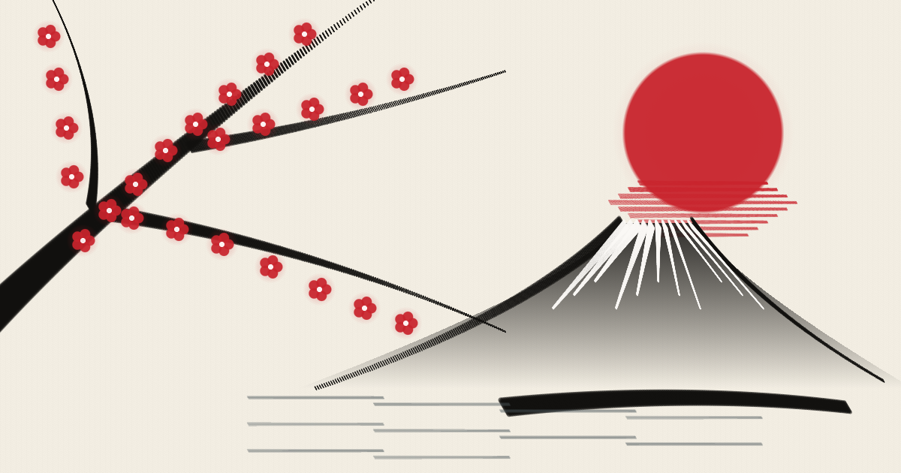

<div align="center">

# 墨 SumiForge · `@sumi-forge/react`

**Onde a Web deixa de ser código e vira pintura viva.**  
*Biblioteca React de arte japonesa procedural, revelação de imagens a pincel, sensibilidade à pressão no toque/mouse e cenários vivos em papel Washi.*

[](https://www.npmjs.com/)
[](https://react.dev/)
[](https://www.typescriptlang.org/)
[](https://developer.mozilla.org/en-US/docs/Web/API/Canvas_API)
[](#pintura-e-revelacao-no-mobile)
[](./LICENSE.md)
[](./CONTRIBUTING.md)

<br />



<br />

[**Explorar Obra Viva**](#visao-geral) · [**Instalação**](#instalacao) · [**Componentes React**](#componentes-principais) · [**Pintura no Mobile**](#pintura-e-revelacao-no-mobile) · [**Como Contribuir**](./CONTRIBUTING.md)

</div>

---

## 一期一会 · Visão Geral (`Ichigo Ichie`)

> *"Cada encontro e cada pincelada são únicos na vida."*

**`@sumi-forge/react`** transforma aplicações React em pergaminhos vivos inspirados na arte japonesa tradicional (**Sumi-e**, **Suibokuga**, **Tarashikomi** e **Ukiyo-e**). Sem depender de vídeos pesados ou arquivos estáticos repetitivos, cada montanha, flor de cerejeira, rio de carpas e golpe de pincel nasce em tempo real na tela e adapta-se com nitidez absoluta a celulares, tablets e monitores ultrawide.

### Por que usar o `@sumi-forge/react`?

- **Cerimônia de Abertura em 3 Atos**: O Sol Carmesim surge como mancha de aquarela úmida (*Tarashikomi*), os traços de nanquim revelam o Monte Fuji e os galhos da cerejeira, e as flores de Sakura desabrocham como manchas vivas sobre a madeira.
- **Revelação Artística de Imagens (`<SumiMaskReveal />`)**: Revele qualquer fotografia ou arte com golpes de pincel animados ou deixe que o próprio visitante revele a imagem passando o dedo na tela do celular.
- **Atelier com Pressão e Velocidade (`<SumiBrushCanvas />`)**: Suporte nativo a telas sensíveis ao toque (iOS/Android), Apple Pencil, Wacom e mouse. Movimentos lentos depositam nanquim denso; movimentos rápidos abrem as cerdas secas (*Kasure*) ou fazem brotar flores de Sakura.
- **Performance Extrema (60/120 FPS)**: Arquitetura com cache offscreen inteligente e pausa automática fora da tela (`IntersectionObserver`), garantindo rolagem fluida mesmo em smartphones intermediários.
- **UI Desenhada à Mão (`<SumiButton />` & `<SumiIcon />`)**: Botões com bordas retas orgânicas e ícones caligráficos vetoriais gerados proceduralmente.

---

## Instalação

Instale o pacote com seu gerenciador favorito:

```bash
# Usando npm
npm install @sumi-forge/react

# Usando pnpm
pnpm add @sumi-forge/react

# Usando yarn
yarn add @sumi-forge/react
```

---

## Componentes Principais

### 1. `<SumiMaskReveal />` · Revelação de Imagens a Pincel & Toque

Envolva qualquer imagem para que ela seja pintada ao vivo na tela ou revelada pelo dedo do usuário no celular.

```tsx
import { SumiMaskReveal } from '@sumi-forge/react';

export function ProductHeroArtwork() {
  return (
    <div className="w-full h-[420px] rounded-2xl overflow-hidden">
      <SumiMaskReveal
        src="/assets/minha-obra.png"
        choreography="fuji_masterpiece" // 'fuji_masterpiece' | 'katana_slashes' | 'hokusai_tide' | 'enso_spiral' | 'interactive_brush'
        duration={3.2}
        bristleCount={26}
        dryBrushGap={0.28}
        showLiveInkAccents={true}
        interactiveBrush={true}
        showTouchControls={true}
      />
    </div>
  );
}
```

| Propriedade | Tipo | Padrão | Descrição |
| :--- | :--- | :--- | :--- |
| `src` | `string` | Obra Monte Fuji | URL ou Data URI da imagem a ser revelada pela máscara caligráfica. |
| `choreography` | `MaskChoreography` | `'fuji_masterpiece'` | Coreografia da revelação (`'fuji_masterpiece'`, `'katana_slashes'`, `'hokusai_tide'`, `'enso_spiral'`, `'interactive_brush'`). |
| `duration` | `number` | `3.4` | Duração da cerimônia de revelação em segundos. |
| `bristleCount` | `number` | `26` | Quantidade de cerdas de bambu no pincel (8 a 40). |
| `dryBrushGap` | `number` | `0.28` | Intensidade da textura de pincel seco *Kasure* (0.0 a 0.85). |
| `interactiveBrush` | `boolean` | `true` | Permite tocar ou arrastar o dedo/mouse para pintar e revelar novas áreas. |
| `showTouchControls` | `boolean` | `true` | Exibe a barra flutuante para alternar entre **Pintar do Zero (Toque)** e **Auto-Revelar**. |

---

### 2. `<SumiSansui />` · Paisagens Gerativas *Sansui* por Seed & Tema

Gera pinturas orientais de montanhas e águas (*Shan-Shui* / *Sansui* 山水) 100% procedurais e determinísticas por `seed`, com cristas caligráficas variáveis, hachuras internas de rocha (*Cunfa* 皴法), neblina na base das montanhas, florestas densas de pinheiros em nanquim, pavilhão tradicional (*Azumaya*) nas escarpas, bandos de grous e barco solitário. Suporta **Auto-Pintura progressiva** ao entrar na tela (`autoPaint`, `paintOnView`) ou renderização estática imediata (`autoPaint={false}`), além de adaptar-se a temas prontos, **Modo Noturno** (`night_obsidian`), **Cores Personalizadas** ou **Variáveis CSS** do seu projeto (`theme="auto"`).

```tsx
import { SumiSansui } from '@sumi-forge/react';

export function GenerativeSansuiBanner() {
  return (
    <div className="w-full h-[380px] rounded-2xl overflow-hidden">
      <SumiSansui
        composition="dense_pine_sanctuary" // 'panoramic_river' | 'karst_peaks' | 'layered_valley' | 'twin_gorges' | 'dense_pine_sanctuary'
        seed={8472}
        theme="jade_mineral" // 'classic_washi' | 'jade_mineral' | 'night_obsidian' | 'crimson_dawn' | 'cobalt_porcelain' | 'auto'
        ridgeLayers={5}
        treeDensity={1.45}
        mistDensity={1.0}
        showBoat={true}
        autoPaint={true}
        paintOnView={true}
        paintDuration={2.5}
        animated={true}
      />
    </div>
  );
}
```

| Propriedade | Tipo | Padrão | Descrição |
| :--- | :--- | :--- | :--- |
| `composition` | `SansuiComposition` | `'panoramic_river'` | Composição estrutural (`'panoramic_river'`, `'karst_peaks'`, `'layered_valley'`, `'twin_gorges'`, `'dense_pine_sanctuary'`). |
| `seed` | `number` | `8472` | Semente numérica determinística: a mesma seed recria exatamente a mesma cordilheira e vegetação. |
| `theme` | `SansuiThemeId` | `'classic_washi'` | Paleta pronta (`'classic_washi'`, `'jade_mineral'`, `'night_obsidian'`, `'crimson_dawn'`, `'cobalt_porcelain'`) ou `'auto'` (lê `--sumi-bg`, `--sumi-ink`, `--sumi-wash` e `.dark`). |
| `autoPaint` | `boolean` | `true` | Quando `true`, pinta a paisagem progressivamente (aguada mineral → cristas e hachuras *Cunfa* → florestas, pavilhão e barco). Quando `false`, exibe a pintura pronta imediatamente. |
| `paintOnView` | `boolean` | `true` | Aguarda o componente entrar na tela (`IntersectionObserver`) para iniciar a cerimônia de auto-pintura. |
| `paintDuration` | `number` | `2.4` | Duração da cerimônia de auto-pintura em segundos. |
| `backgroundColor` | `string` | `undefined` | Sobrescreve livremente a cor de fundo do pergaminho. |
| `inkColor` | `string` | `undefined` | Sobrescreve livremente a cor dos traços de contorno, hachuras e árvores. |
| `washColor` | `string` | `undefined` | Sobrescreve livremente a cor da aguada mineral interna das montanhas. |
| `ridgeLayers` | `number` | `5` | Quantidade de planos atmosféricos de montanhas (2 a 8). |
| `treeDensity` | `number` | `1.0` | Densidade de pinheiros e árvores caligráficas nas encostas (0.0 a 2.0). |
| `showBoat` | `boolean` | `true` | Exibe a embarcação solitária deslizando nas águas calmas. |
| `actionsRef` | `RefObject` | `undefined` | Expõe `exportPng()`, `randomizeSeed()` e `replayPaint()` para controle imperativo. |

---

### 3. `<SumiLandscape />` · Paisagem 100% Procedural do Monte Fuji & Sakura

Renderiza a cena viva do Monte Fuji, Sol Vermelho, Ilha de Pinheiros e Galho de Cerejeira com pétalas reagindo à brisa e ao cursor/toque.

```tsx
import { useRef } from 'react';
import { SumiLandscape, DEFAULT_FUJI_LAYERS } from '@sumi-forge/react';

export function LivingHeroBackground() {
  const revealProgressRef = useRef<number>(1);

  return (
    <div className="w-full h-screen">
      <SumiLandscape
        revealProgressRef={revealProgressRef}
        layers={DEFAULT_FUJI_LAYERS}
        windSpeed={1.05}
        animated={true}
        interactive={true}
      />
    </div>
  );
}
```

---

### 3. `<SumiBrushCanvas />` · Atelier de Pintura com Pressão Real

Tela de pintura multi-camadas em papel Washi com 6 estilos de pincéis orientais e suporte completo a toque no celular.

```tsx
import { SumiBrushCanvas, MAGIC_SCHOOLS } from '@sumi-forge/react';

export function InteractivePaintingPad() {
  return (
    <div className="w-full h-[460px] rounded-xl overflow-hidden">
      <SumiBrushCanvas
        activeBrush="sakura_branch" // 'sakura_branch' | 'sumi_kasure' | 'hokusai_wave' | 'suibokuga_flame' | 'kumo_cloud' | 'tarashikomi_wash'
        colors={MAGIC_SCHOOLS.fuji_sakura.colors}
        strokeThickness={1.3}
        bristleCount={26}
        dryBrushGap={0.32}
        activeLayer="foreground"
        showReferenceGuide={true}
      />
    </div>
  );
}
```

---

### 4. `<SumiSectionPainter />` · Cenários que Pintam no Scroll

Pinta fundos de seção sincronizados com a rolagem da página (Galhos de Sakura, Rio de Carpas Koi, Cordilheiras na Neblina e Selo Imperial Ensō).

```tsx
import { useRef } from 'react';
import { SumiSectionPainter } from '@sumi-forge/react';

export function KoiRiverSection() {
  const scrollProgressRef = useRef<number>(0.65);

  return (
    <section className="relative py-24 overflow-hidden">
      <div className="absolute inset-0 z-0">
        <SumiSectionPainter
          theme="koi_river_rapids" // 'sakura_katana_canopy' | 'koi_river_rapids' | 'misty_mountains_sakura' | 'enso_imperial_seal'
          scrollProgressRef={scrollProgressRef}
          school="calligraphy_tide"
        />
      </div>
      <div className="relative z-10">
        {/* Conteúdo da seção com cards em glassmorphismo */}
      </div>
    </section>
  );
}
```

---

### 5. `<SumiButton />`, `<SumiIcon />` & `<JapaneseCalligraphy />`

Componentes de interface desenhados à mão com estética Samurai e selos japoneses (*Hanko*) com tradução interativa para Português Brasileiro ao tocar ou passar o mouse.

```tsx
import { SumiButton, SumiIcon, JapaneseCalligraphy } from '@sumi-forge/react';

export function SamuraiHeaderActions() {
  return (
    <div className="flex items-center gap-3">
      <JapaneseCalligraphy
        jp="花鳥風月"
        romaji="Kachō Fūgetsu"
        pt="Contemplar a beleza da natureza, das flores, do vento e da lua"
        variant="hanko"
      />

      <SumiButton variant="crimson" size="md">
        <SumiIcon name="brush" size={18} color="#11100E" />
        <span>Abrir Playground</span>
      </SumiButton>
    </div>
  );
}
```

---

## Pintura e Revelação no Mobile

O `@sumi-forge/react` foi projetado para oferecer uma experiência tátil de primeira classe em smartphones e tablets:

1. **Bloqueio Inteligente de Gestos (`touch-action: none`)**: Ao deslizar o dedo sobre o `<SumiMaskReveal />` ou `<SumiBrushCanvas />`, a página não rola acidentalmente, garantindo traços contínuos e precisos.
2. **Toque Simples (*Single-Tap Stamp*)**: Um único toque na tela do celular estampa automaticamente uma mancha de aquarela *Tarashikomi* acompanhada por um golpe caligráfico e flores de cerejeira.
3. **Modo "Pintar do Zero (Toque)"**: Limpa a máscara automática e exibe uma suave silhueta em papel Washi (12% de opacidade) para que o usuário revele a obra inteira passando o dedo na tela.
4. **Traços Iniciais Responsivos**: No Atelier, a composição inicial do Monte Fuji e Sakura redimensiona suas coordenadas proporcionalmente à tela do celular.

---

## Desenvolvimento Local

```bash
# 1. Instale as dependências
npm install

# 2. Inicie o servidor de desenvolvimento (porta 3000)
npm run dev

# 3. Verifique a tipagem e o build de produção
npm run lint
npm run build
```

---

## Documentação e Governança do Projeto

- [Guia de Contribuição (`CONTRIBUTING.md`)](./CONTRIBUTING.md)
- [Código de Conduta (`CODE_OF_CONDUCT.md`)](./CODE_OF_CONDUCT.md)
- [Template de Pull Request (`.github/PULL_REQUEST_TEMPLATE.md`)](./.github/PULL_REQUEST_TEMPLATE.md)
- [Licença Apache 2.0 (`LICENSE.md`)](./LICENSE.md)

---

<div align="center">

**墨 SumiForge · `@sumi-forge/react`**  
*made with love in Japa.... ops, Brazil* 🇧🇷 ❤️ 🇯🇵

</div>
